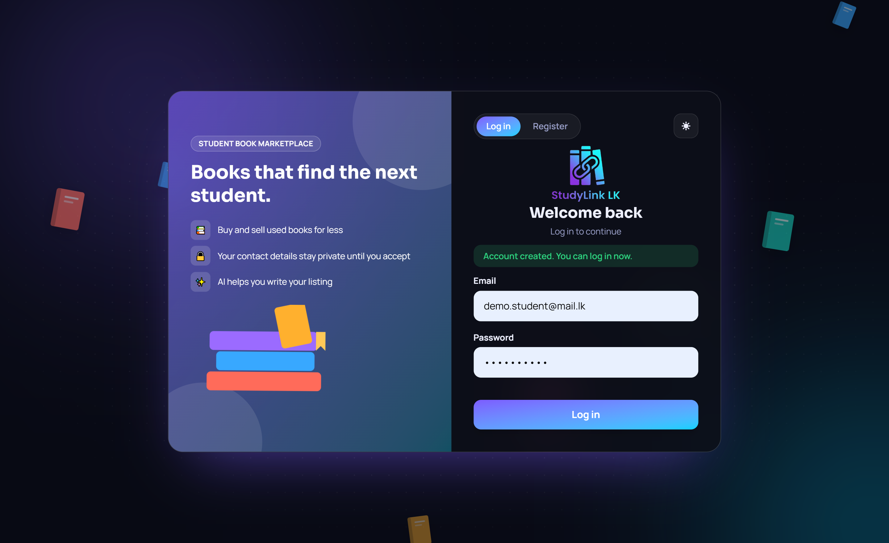
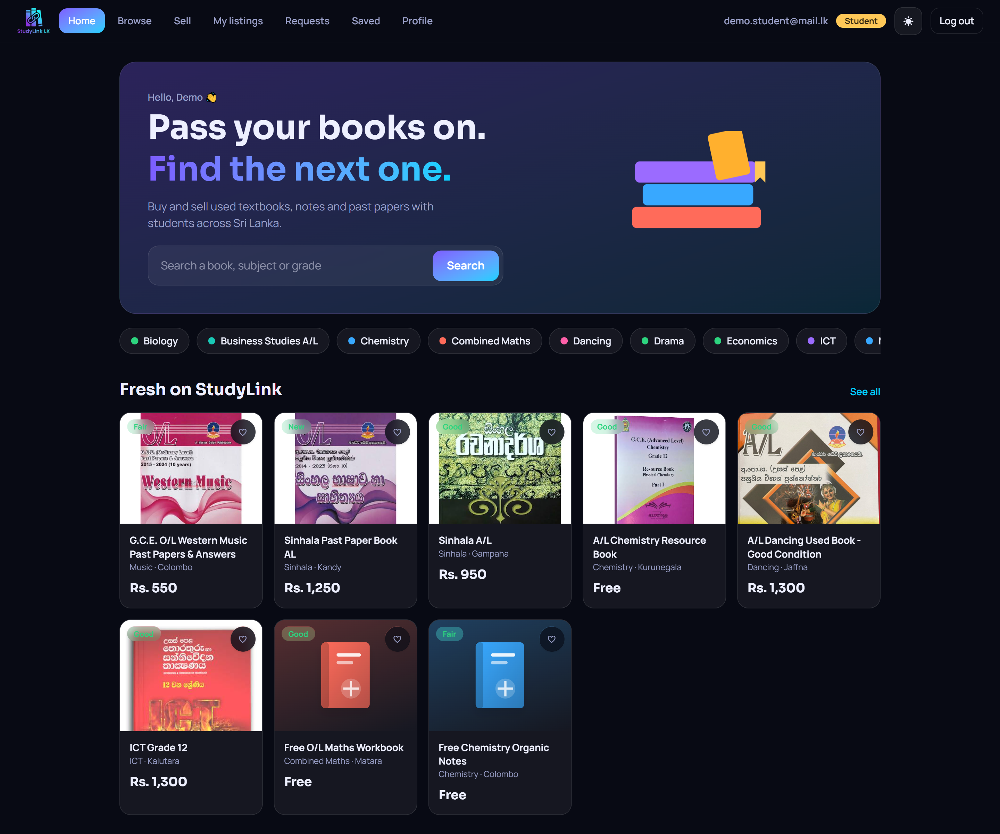
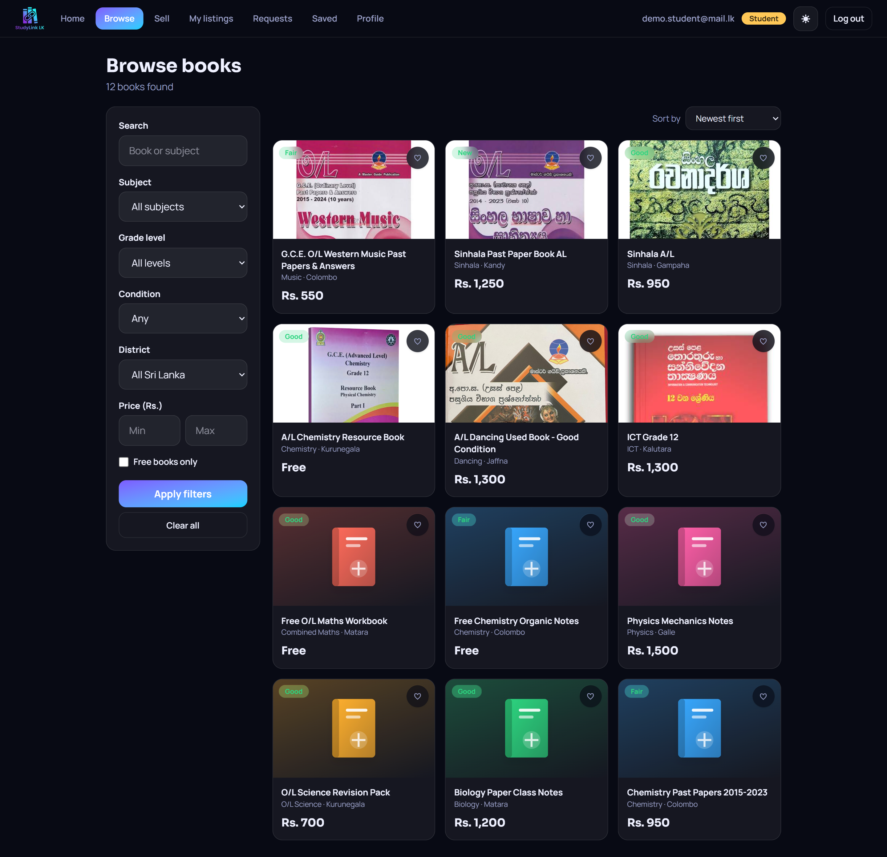
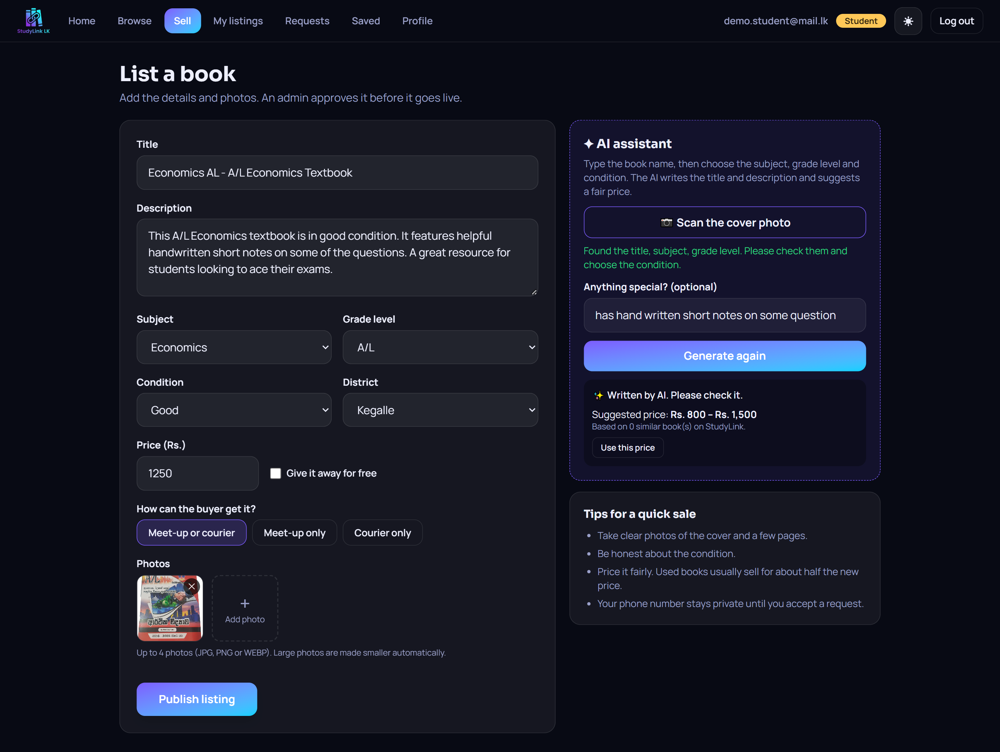
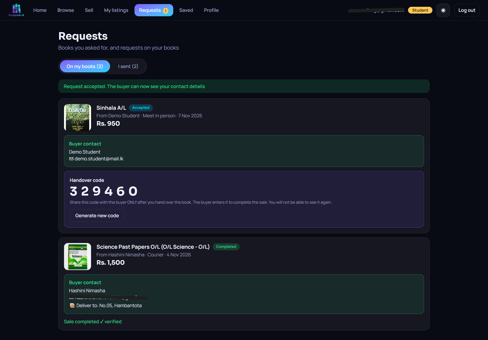
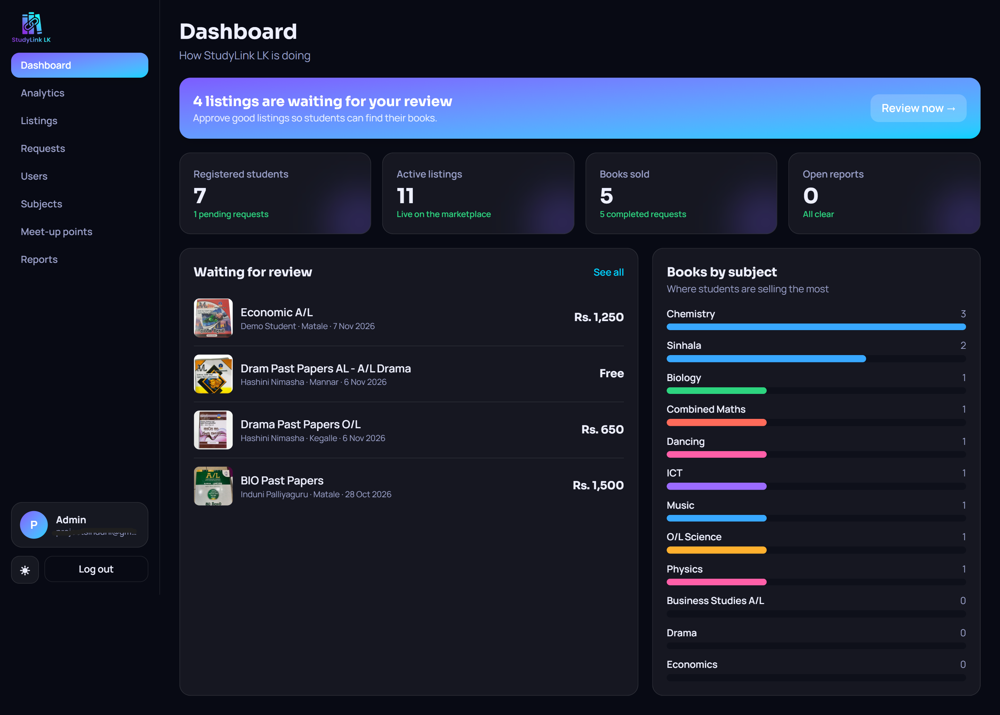
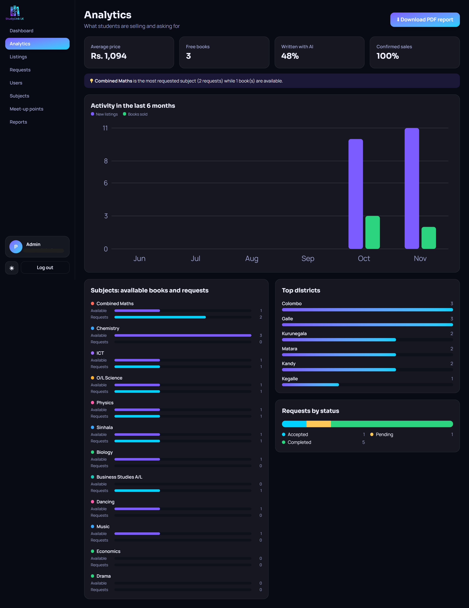
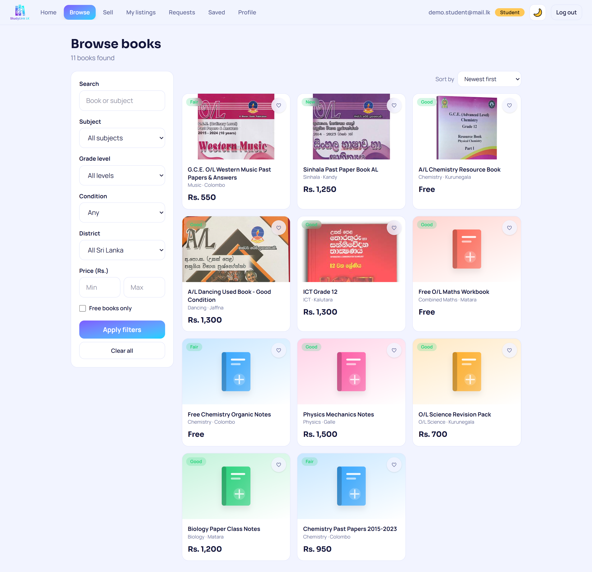
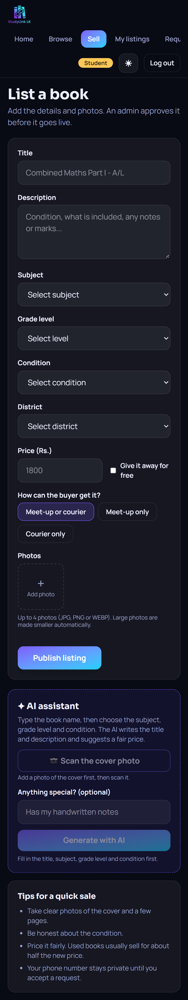

# StudyLink LK: Frontend

Web app for **StudyLink LK**, a marketplace where Sri Lankan students buy, sell and pass on used textbooks, notes and past papers.

Built for the **ITS2020 Rapid Application Development** final coursework (IJSE, Graduate Diploma in Software Engineering).

|                        |                                                                |
| ---------------------- | -------------------------------------------------------------- |
| **Live site**          | https://studylink-web.vercel.app/login                         |
| **Live API**           | https://studylink-api-delta.vercel.app/                        |
| **Backend repository** | https://github.com/InduniPalliyaguru/Study-Link-LK-Backend.git |

<p align="center">
  
</p>

## Demo accounts

| Role    | Email                                                                 | Password     |
| ------- | --------------------------------------------------------------------- | ------------ |
| Student | `demo.student@mail.lk`                                                | `Demo@12345` |
| Admin   | Shared privately                                                      |              |

> The first request after a quiet period can take a few seconds while the serverless backend wakes up.

---

## Features

### Students

- Register and log in (JWT with automatic token refresh)
- Browse with search, filters (subject, grade, condition, district, price, free books), sorting and pagination
- Book details with photos, seller rating, and a request form (meet-up or courier)
- Sell a book: photo upload (compressed in the browser), **AI assistant** (title, description, price range) and **AI cover scan**
- My listings with status, edit, delete, and the reason if an admin rejected it
- Requests: accept or reject, **one-time handover code**, courier shipping, confirm receipt, rate the seller
- Saved books, profile, password change, reviews about me
- Email notifications for requests and approvals

### Admins

- Dashboard with live statistics and subject chart
- Approve or reject listings (with a reason), view photos
- Users: search, block, unblock, delete
- Requests monitor, subjects and grade levels, safe meet-up points
- Reports: dismiss, remove listing, block seller
- **Analytics** with charts and a **PDF report**

### Screenshots

| Home                               | Browse                                 |
| ---------------------------------- | -------------------------------------- |
|  |  |

| Sell with AI                       | Requests and handover code                 |
| ---------------------------------- | ------------------------------------------ |
|  |  |

| Admin dashboard                                    | Admin analytics                                    |
| -------------------------------------------------- | -------------------------------------------------- |
|  |  |

| Light mode                                | Mobile                                 |
| ----------------------------------------- | -------------------------------------- |
|  |  |

---

## Tech stack

**React 19** (functional components and hooks), **TypeScript**, **Redux Toolkit** (auth, catalog, listings, saved books), React Router, **TailwindCSS 4**, Axios (with a token refresh interceptor), jsPDF (PDF report). Built with Vite and deployed on **Vercel**.

## Project structure

```
src/
  app/          Redux store and typed hooks
  features/     Redux slices (auth, catalog, listings, saved, requests)
  services/     Axios instance with interceptors, token storage
  routes/       RequireRole (route guard)
  layouts/      StudentLayout (top navbar), AdminLayout (sidebar)
  pages/        student pages and pages/admin
  components/   reusable UI (ListingCard, Pagination, modals, charts...)
  utils/        helpers (format, errors, image compression, PDF report)
  types/        shared TypeScript types
vercel.json     single page app rewrite
```

## Design

Dark mode by default with a light mode switch, glass cards, a violet to cyan gradient taken from the logo, and a colour for every subject (book spines). Responsive from phone to desktop, keyboard friendly (visible focus rings, labelled forms, dialogs close with Esc) and it respects the "reduce motion" setting.

---

## Run it locally

**Requirements:** Node.js 20 or newer and the backend running (see the backend repository).

```bash
git clone https://github.com/InduniPalliyaguru/Study-Link-LK-Frontend.git
cd Study-Link-LK-Frontend
npm install
```

Create a `.env` file (copy `.env.example`):

```
VITE_API_BASE_URL=http://localhost:5000/api/v1
```

```bash
npm run dev       # http://localhost:5173
npm run build     # production build
```

> Only `VITE_` variables are sent to the browser, so never put secrets in this file.

## Deployment

- **Frontend:** Vercel (set `VITE_API_BASE_URL` to the live API address)
- **Backend:** Vercel serverless functions
- **Database:** MongoDB Atlas
- **Images:** Supabase Storage

`vercel.json` sends every address to `index.html`, so pages like `/browse` work after a refresh.

## Author

**Induni Palliyaguru**: Graduate Diploma in Software Engineering, IJSE.
Module: ITS2020 Rapid Application Development.
